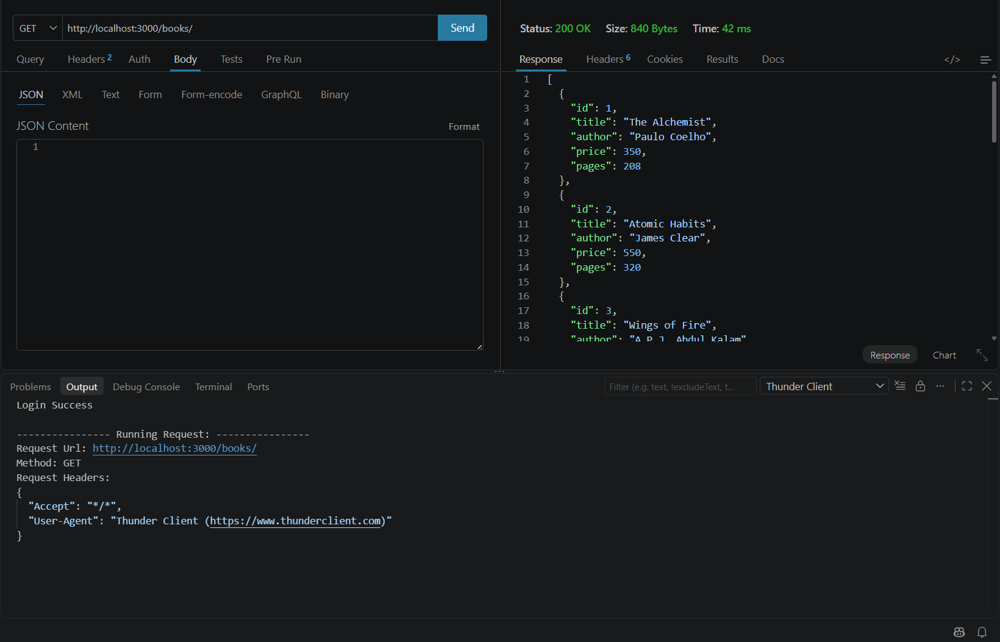
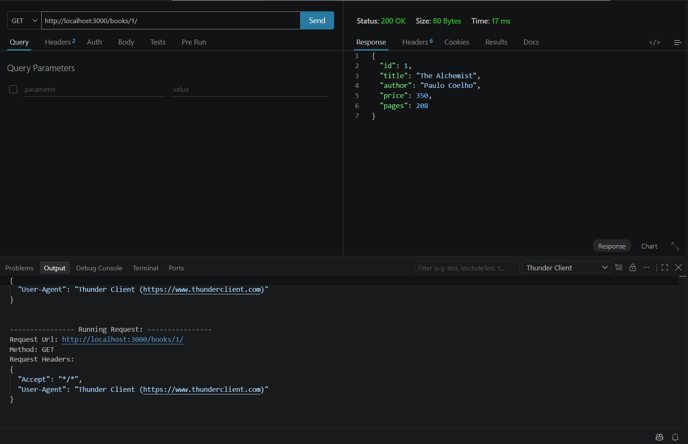
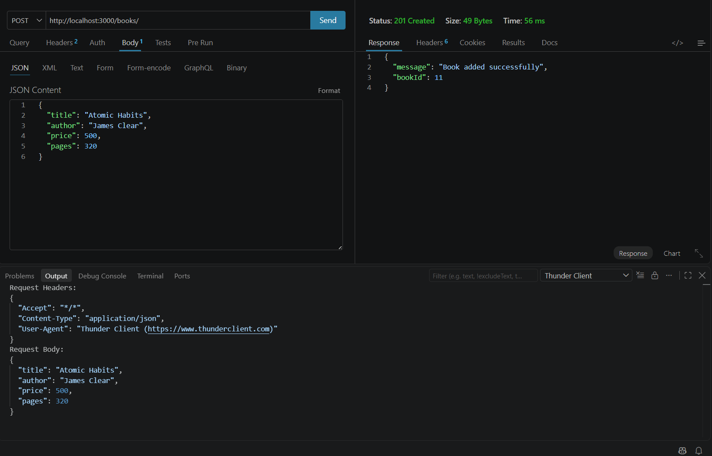
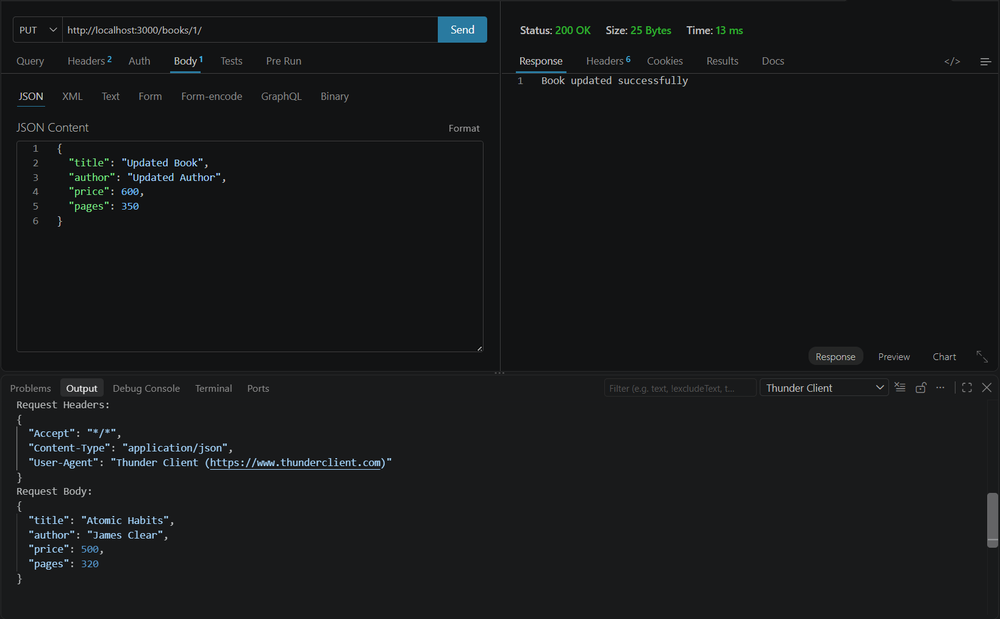
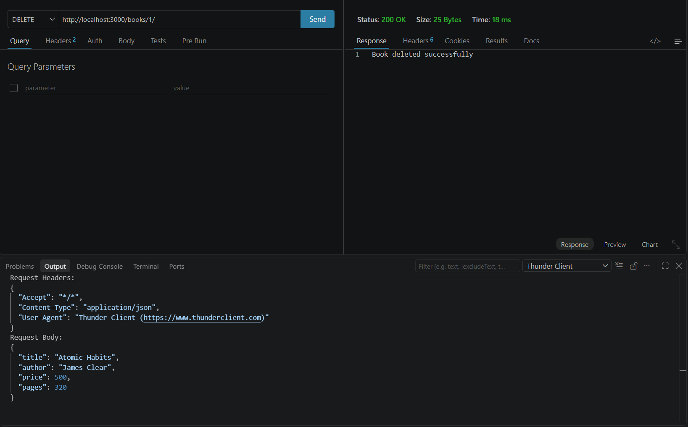
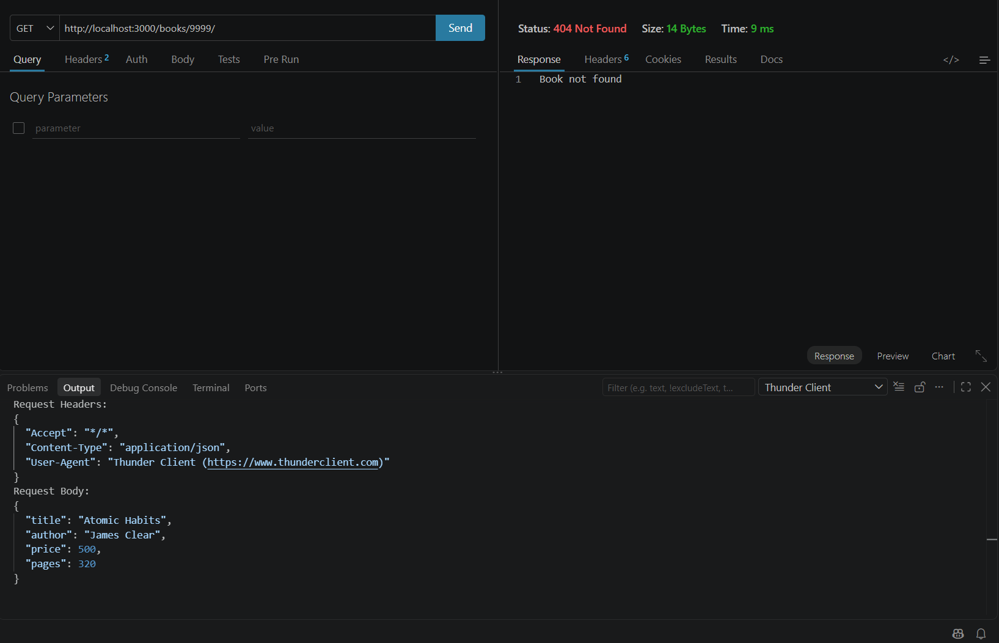

# Lab 2: SQLite Database and CRUD Routes

## Student Details

**Name:** Srihasini Nayakoti  
**Registration Number:** 252U1R1167  
**Section:** CSE-2D  

## Live Link

**Not deployed:** The application is currently tested locally using `http://localhost:3000`.

The project can be run locally using Node.js and Thunder Client.

## Objective

The objective of this lab is to connect an Express.js server with a SQLite database and implement CRUD operations through HTTP routes.

The application manages a collection of books stored in a SQLite database named `books.db`.

## Technologies Used

- Node.js
- Express.js
- SQLite
- sqlite3
- Nodemon
- Thunder Client
- JavaScript

## Project Structure

```text
Lab-02/
│
├── database/
│   └── books.db
│
├── screenshots/
│   ├── get-all-books.png
│   ├── get-one-book.png
│   ├── post-book.png
│   ├── put-book.png
│   ├── delete-book.png
│   └── 404-book.png
│
├── .gitignore
├── package.json
├── package-lock.json
├── server.js
└── README.md
```

## How to Run

### 1. Clone the repository

```bash
git clone YOUR_GITHUB_REPOSITORY_LINK
```

### 2. Navigate to the Lab 2 folder

```bash
cd Lab-02
```

### 3. Install dependencies

```bash
npm install
```

### 4. Start the server using Nodemon

```bash
npm run dev
```

The server runs at:

```text
http://localhost:3000
```

No environment variables are required for this lab.

## Database

The project uses SQLite for storing book information.

The `book` table contains the following fields:

| Field | Type | Description |
|---|---|---|
| id | INTEGER | Primary key |
| title | TEXT | Book title |
| author | TEXT | Book author |
| price | INTEGER | Book price |
| pages | INTEGER | Number of pages |

The database file is:

```text
database/books.db
```

## Endpoints

| Method | Path | Description |
|---|---|---|
| GET | `/books/` | Returns all books |
| GET | `/books/:bookId/` | Returns a specific book |
| POST | `/books/` | Adds a new book |
| PUT | `/books/:bookId/` | Updates an existing book |
| DELETE | `/books/:bookId/` | Deletes a book |

## API Testing

All endpoints were tested using Thunder Client in Visual Studio Code.

### 1. GET All Books

Returns all books available in the SQLite database.



### 2. GET One Book

Returns the details of a specific book using its book ID.



### 3. POST Book

Adds a new book to the SQLite database.



### 4. PUT Book

Updates the details of an existing book.



### 5. DELETE Book

Deletes a book from the SQLite database.



### 6. 404 Error

Returns a `404 Not Found` response when the requested book does not exist.



## Parameterised Queries

The application uses `?` placeholders for values received from the user.

This helps prevent SQL injection and keeps database queries safe.

For example:

```sql
SELECT * FROM book WHERE id = ?
```

The user-provided value is passed separately instead of being directly concatenated into the SQL query.

## Status Codes

The application returns appropriate HTTP status codes for different operations.

- `200 OK` – Successful GET, PUT and DELETE operations
- `201 Created` – Successful POST operation
- `404 Not Found` – Requested book does not exist
- `500 Internal Server Error` – Server/database error
