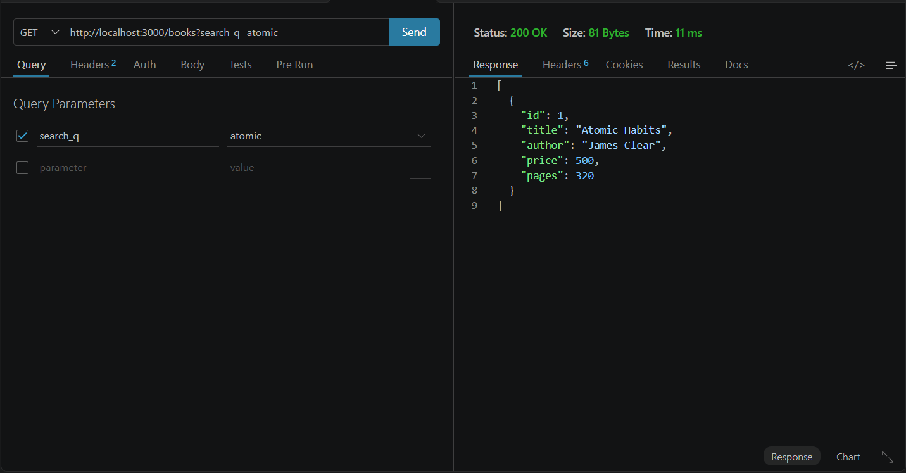
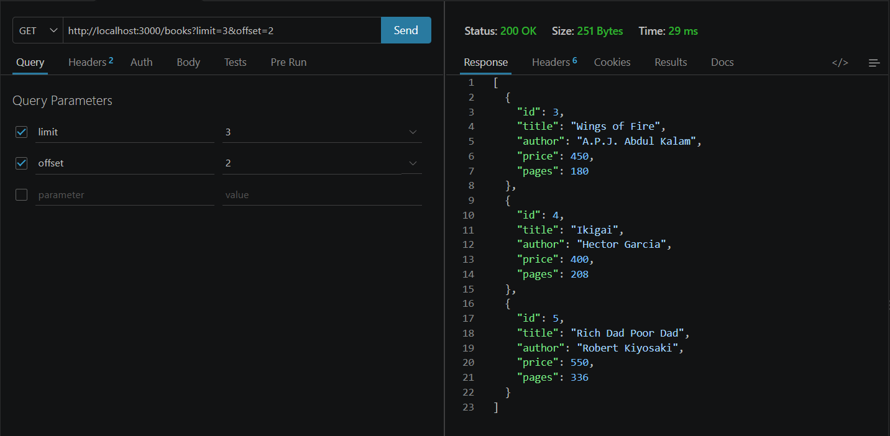
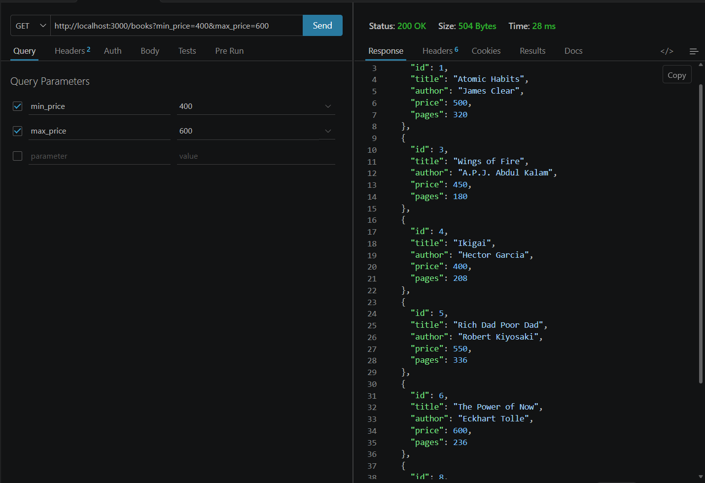
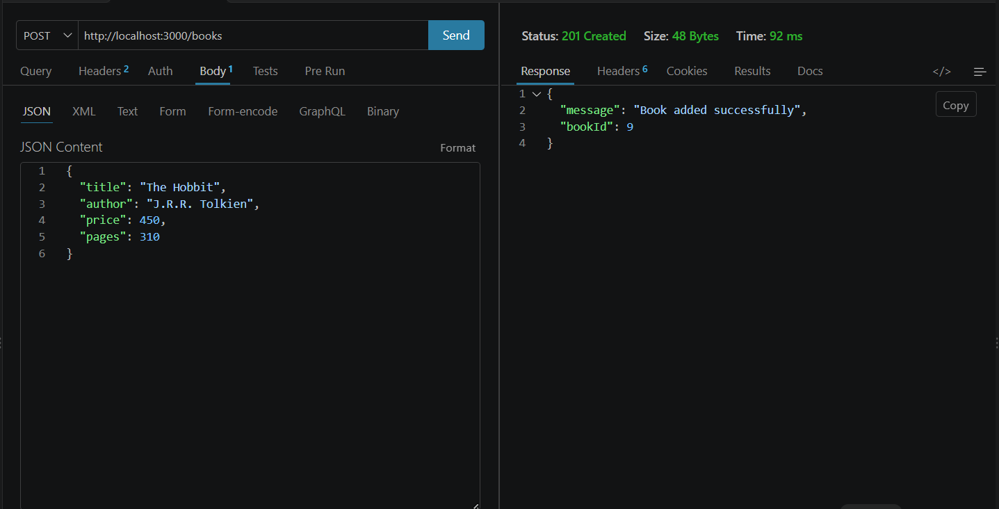
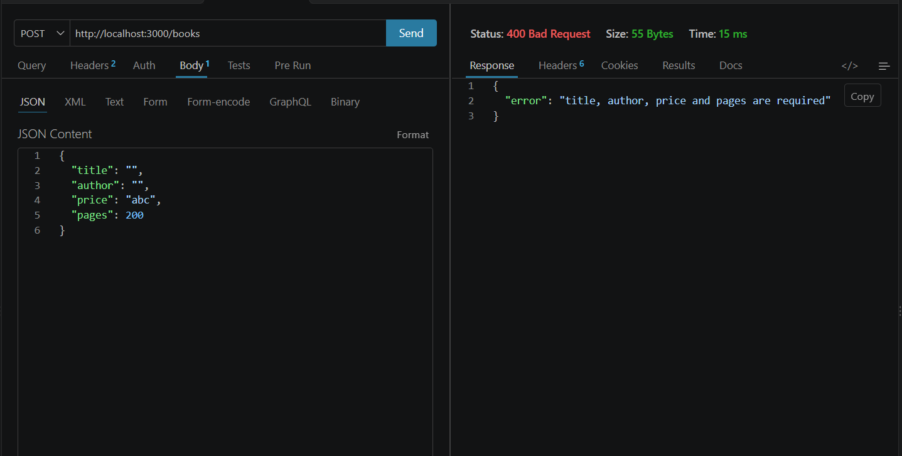
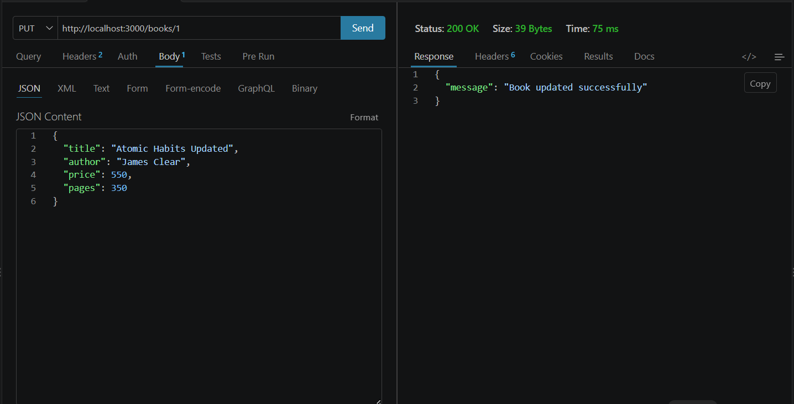
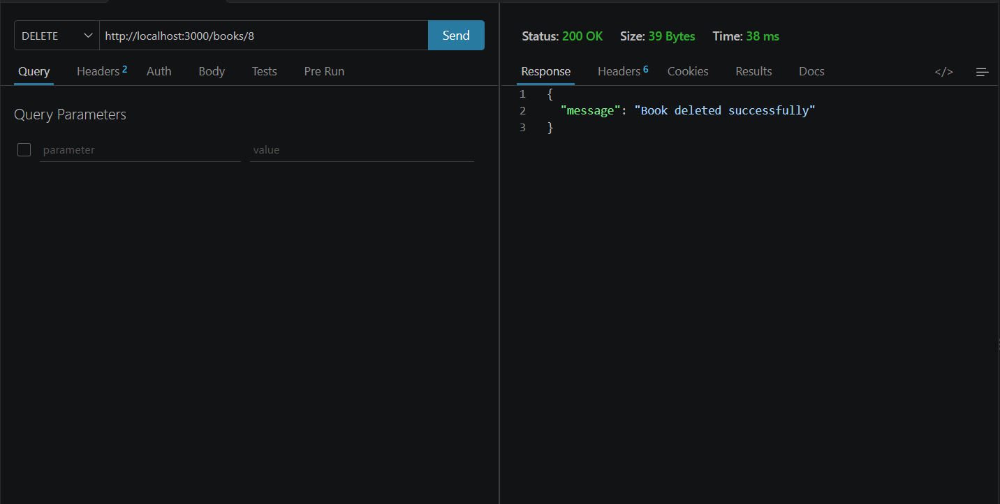
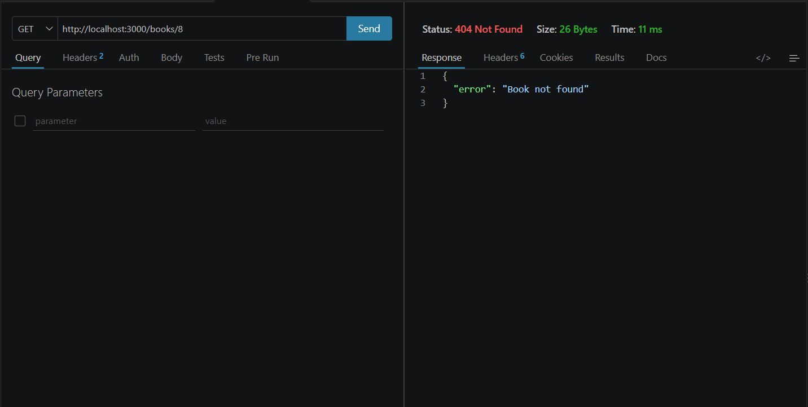

# Lab 3: REST API, Query Parameters and Validation

## Student Details

**Name:** Srihasini Nayakoti  
**Registration Number:** YOUR_REGISTRATION_NUMBER  
**Section:** YOUR_SECTION  

## Live Link

Not deployed. The application was tested locally using:

`http://localhost:3000`

## Objective

To develop a REST API using Node.js, Express.js, and SQLite with query parameters, request validation, appropriate HTTP status codes, and debugging practices.

## Technologies Used

- Node.js
- Express.js
- SQLite
- sqlite3
- Thunder Client
- Nodemon
- JavaScript

## How to Run

1. Open the `Lab-03` folder in VS Code.
2. Open the terminal.
3. Install dependencies:

```bash
npm install
```

4. Start the development server:

```bash
npm run dev
```

5. The server runs at:

`http://localhost:3000`

## API Endpoints

| Method | Endpoint | Description |
|---|---|---|
| GET | `/books` | Get all books |
| GET | `/books/:bookId` | Get a single book |
| POST | `/books` | Add a new book |
| PUT | `/books/:bookId` | Update a book |
| DELETE | `/books/:bookId` | Delete a book |

## Query Parameters

### Search

```text
GET /books?search_q=atomic
```

### Sorting

```text
GET /books?order_by=price&order=ASC
```

```text
GET /books?order_by=price&order=DESC
```

### Limit

```text
GET /books?limit=3
```

### Offset

```text
GET /books?limit=3&offset=2
```

### Price Filtering

```text
GET /books?min_price=400&max_price=600
```

## Validation

The POST endpoint validates:

- Required `title`
- Required `author`
- Numeric `price`
- Numeric `pages`

Invalid requests return HTTP `400 Bad Request`.

## HTTP Status Codes

| Status Code | Usage |
|---|---|
| 200 | Successful GET, PUT and DELETE |
| 201 | Successfully created a book |
| 400 | Invalid request data |
| 404 | Book not found |

## Screenshots

### 1. Search Books



### 2. Sort Books


### 3. Limit and Offset



### 4. Price Filter



### 5. Valid POST



### 6. Invalid POST



### 7. PUT Book



### 8. DELETE Book



### 9. 404 Book Not Found



## Problems Faced

During development, issues related to server execution, API testing, query parameters, validation, and route handling were identified and resolved.

## Conclusion

The REST API was successfully developed using Express.js and SQLite. The application supports CRUD operations, query parameters, input validation, appropriate HTTP status codes, and error handling.